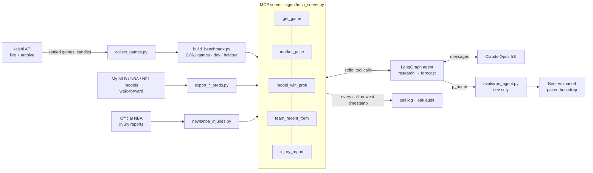

# Kalshi sports research agent

An LLM research agent that forecasts NBA, MLB and NFL game winners through point-in-time tools, benchmarked against
Kalshi prediction-market prices on a frozen, leak-audited set of 2,861 settled 2026 games.

**Result:** the agent matches the market but does not beat it. Across every test (my own statistical models, a fitted
market-plus-model blend, the LLM agent, and an agent with official injury reports), one-hour-ahead Kalshi sports prices
already contain the signal from my own models and from official injury reports. The agent forecasts at about
$0.04–0.06 and 10–11 seconds per game, with zero lookahead leaks logged across every run.

### Holdout (scored once, pre-registered in [`SPEC.md`](benchmark/SPEC.md) before any holdout result was computed)

| System | Holdout games | Brier | − market (95% CI) |
|---|---|---|---|
| **Market at t** (1 h before) | 887 | **0.2269** | — |
| Market + model blend (fit on dev) | 887 | 0.2282 | +0.0013 (+0.0002 to +0.0024), worse |
| My models alone | 887 | 0.2303 | +0.0034 (+0.0001 to +0.0068), worse |
| **Agent v1** (Claude Opus 5.5, 4 tools) | 100-game sample | **0.2280** vs market 0.2297 | −0.0017 (−0.0037 to +0.0003), no detectable edge |

The market is the best single forecaster on fresh games. My models and the blend fit on dev were both worse than the
market on the holdout (my NBA model degraded this fall: +0.0206, CI +0.0023 to +0.0398). On its 100-game sample the
agent was not worse than the market; agent versus blend was not tested. Agent run: 100 games, 0 errors, 0 leaks,
$4.59, 10 s per game. The blend used on the holdout was refit on all dev games:
`logit(p) = −0.03 + 0.77·logit(market) + 0.10·logit(model)`.

## Architecture



- **The server decides what "before t" means, never the agent.** Every tool takes a game ID, looks up that game's
  decision time t itself, and only returns data from before it. Every call is logged with the newest timestamp it
  returned; a run with any item after t counts as failed.
- **The agent** (LangGraph `research → forecast`) calls the tools in a loop (at most 8 calls), then makes one final call
  with structured output (`p_home`, `confidence`, `key_factors`, `reasoning`). Claude is called through the Anthropic
  SDK with prompt caching; MCP tools through the official MCP client.

## Benchmark (frozen before any agent code; rules in [`benchmark/SPEC.md`](benchmark/SPEC.md))

| Rule | Choice |
|---|---|
| Games | Every settled 2026 Kalshi game-winner market with a known start time: MLB 2,470 · NBA 255 · NFL 136 (preseason excluded) |
| Unit | One row per game (the home team's market), label = home team won |
| Decision time | t = scheduled start − 60 min (a t − 24 h variant was added later) |
| Market price | Bid/ask midpoint of the last hourly candle that **ended** at or before t |
| Split | Chronological 70 / 30 per sport, cut at a date boundary; the holdout is scored once |
| Metric | Brier score; an edge counts only if the 95% paired-bootstrap interval excludes zero |

## Results

All dev numbers below are on the development split; the holdout was scored once at the end (see the top of this page).

**1. My own models vs the market (dev, 1,937 games).** Walk-forward predictions: each season comes from a model
trained only on earlier seasons.

| | Market at t | My models | Always the base rate |
|---|---|---|---|
| Brier | **0.2424** | 0.2443 | 0.2494 |

No detectable difference overall (model − market +0.0019, CI −0.0003 to +0.0041); the market is better in MLB, the
largest sample. Model and market correlate at only 0.86, which is what the agent was meant to exploit.

**2. The agent at t − 1 h (60 dev games, Claude Opus 5.5).** Market **0.2422**, agent 0.2438, my models 0.2518;
agent − market +0.0016 (CI −0.0004 to +0.0035). The agent behaves like a cautious blend: it moves 0.7 points from the
market on average, toward my model in 53 of 60 games. $3.35 total, 5 tool calls per game.

**3. A one-line blend.** `logit(p) = −0.02 + 0.72·logit(market) + 0.15·logit(model)` (fit on dev games outside the
agent's 60). Forward-chained over 1,614 dev
games it does not beat the market (+0.0012, CI −0.0006 to +0.0029), and the agent does no better than it. Conclusion:
one hour before a game, my models add no detectable information to the market price.

**4. Does the market learn in the last day?** Same dev games at t − 24 h vs t − 1 h (1,965 games): the 24-hour price
is worse (+0.0019, CI +0.0004 to +0.0034). In the NBA the gap was concentrated in **preseason**: +0.0189
(CI +0.0027 to +0.0360, 66 games, prices moving 5.9 points on average as teams announce who sits; measured before
preseason games were excluded from the benchmark) versus regular season and playoffs (+0.0017, CI −0.0035 to
+0.0068, 151 games, not significant).

**5. Agent + official NBA injury reports at t − 24 h (60 regular-season/playoff dev games).** Market 0.1896, agent
without injuries 0.1896, agent with injuries 0.1904 (with − without injuries +0.0009, CI −0.0010 to +0.0028). In real games the
injury report is public a day out and already priced; the preseason games where the market did learn late have no
injury reports at all, which is how the benchmark's preseason rule was found.

## Engineering notes
- **Archive bug caught by a coverage check.** At first, 90% of MLB games came out with no price. Kalshi's historical
  archive names candle fields differently from the live API (`close` instead of `close_dollars`). The parser now reads
  both, and the affected files were downloaded again.
- **Point-in-time traps handled explicitly.**
  - A game that started before t may not have ended by t. Recent form only counts a game if its start plus a
    conservative game length is before t.
  - My models' inputs run to midnight on game day, which is after t − 24 h. So the model tool is left out of the
    24-hour variant; the leak audit would flag it otherwise.
  - Injury reports are dated by the report time in the file name, never by when they were downloaded.
- **Checking results before trusting them.** An early "my model beats the market" result came from swapped labels in
  the scoring script. A second, independent check caught it (fixed in commit `0a3fd4a`). Rebuilding the benchmark keeps
  every game's dev/holdout membership, which the build asserts against the frozen split.

## Limitations
- One season of 2026 games: MLB dominates the sample; NBA and NFL results per sport are directional.
- Hourly candles: the price at t can be up to an hour old.
- The agent is a forecaster, not a trader: no fees, sizing or execution are modeled here.
- Only public information was tested. Late team decisions (preseason rest, lineup confirmations) are where the market
  still moves; no clean licensed source for them was used.

## Reproduce
```bash
pip install -r requirements.txt
python run.py collect-games                           # crawl settled MLB/NBA/NFL game markets + hourly candles
python -m benchmark.build_benchmark                   # t = start - 1h (and --lead-hours 24 for the variant)
python -m benchmark.score_baselines                   # market vs my models on dev
python -m benchmark.blend_baseline                    # market + model blend
python -m news.nba_injuries                           # official NBA injury reports (cached, ~1 req/s)
python -m evals.run_agent --n 60 --tag dev60_v1       # agent on 60 dev games (needs ANTHROPIC_API_KEY)
pytest tests/
```
Steps from `score_baselines` on need my models' predictions (`data/model_preds_*.csv`), which come from two separate
private projects (MLB and NBA/NFL); their export scripts are in `benchmark/`.

## Data sources
- **Kalshi** public market data API (read-only; this project never places orders).
- **NBA official injury reports** (league-published PDFs): downloaded once for private research, never redistributed.
- **My model predictions** come from my own private projects. Their inputs include MLB Stats API data, nflverse data
  (CC BY 4.0, credit: the nflverse project) and ESPN's public NBA scoreboard, used for non-commercial research. Only
  aggregate results of my own models are published here; no raw third-party data is in this repo.
- Not affiliated with or endorsed by Kalshi, the NBA, MLB or the NFL. Not betting advice.

## License
Code: MIT (see [`LICENSE`](LICENSE)). Data is not included and is not covered by this license.

## Earlier work
This repo started as a general Kalshi mispricing model (LightGBM correction on market log-odds across 12.4k markets).
That write-up, including why its live edges weren't trustworthy, is in [`docs/mispricing-model.md`](docs/mispricing-model.md).
